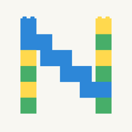
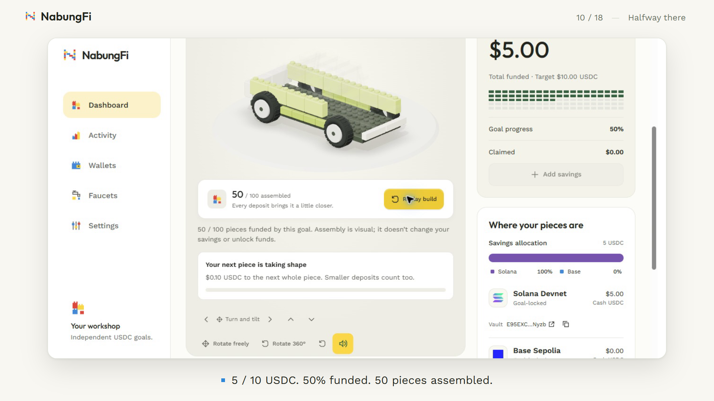
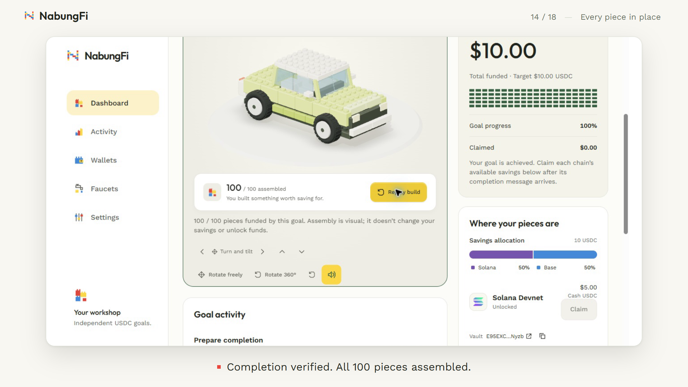
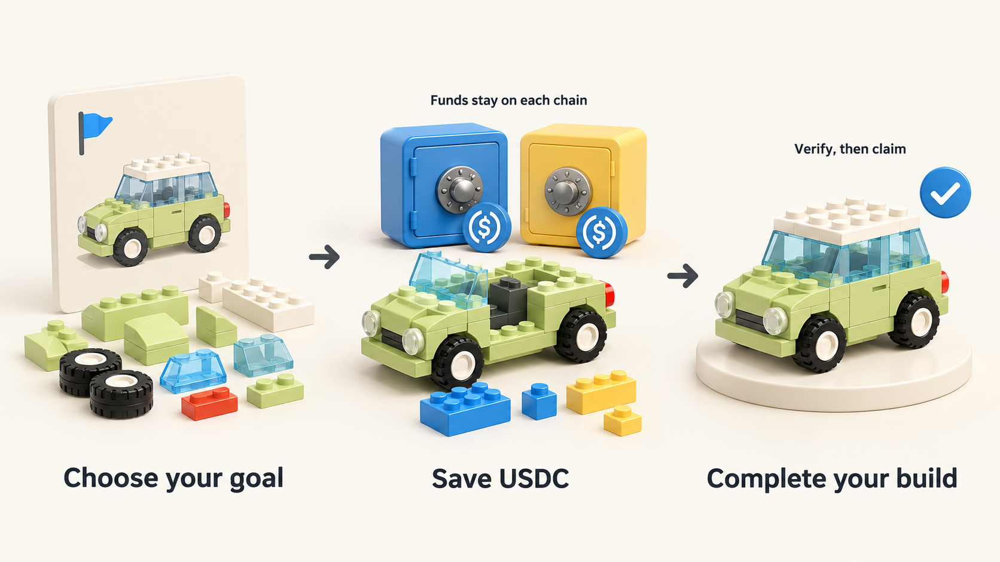

# NabungFi

### Build what you're saving for.

A multichain USDC savings app that turns your goal into a 100-piece 3D build.

**[Open the app](https://nabungfi.endpx.cloud/app)** · **[Watch the demo](https://youtu.be/IL7THrY67Gk)** · **[Watch the pitch](https://youtu.be/RNPb-dib-tM)** · **[Read the docs](https://nabungfi.gitbook.io/nabungfi-docs/)**

## Start here

**For judges:** [review guide](docs/JUDGES_GUIDE.md) · [latest demo receipts](docs/DEMO_EVIDENCE.md) · [verification history](docs/EVIDENCE_HISTORY.md).

The public testnet app supports Google, email and wallet sign-in. Embedded wallets are prepared through Privy. Start a small goal, select its networks, complete vault setup, and deposit testnet USDC. The app's Faucets page links to token sources.

The **2:37 product demo** follows a new **10-USDC car goal** through real wallet approvals, a **5-USDC Solana deposit**, a **5-USDC Base deposit**, verified completion and claims from both vaults. All **eight original owner transactions** reached confirmed status through the application's receipt verifier. [Inspect the recorded lifecycle](docs/DEMO_EVIDENCE.md).

## Why NabungFi

Saving for something specific creates three practical challenges:

| Friction | NabungFi's response |
| --- | --- |
| One shared balance makes a purchase goal easy to lose track of. | A dedicated goal with its own target, vaults and accounting. |
| Spendable savings make a commitment easy to reverse. | A voluntary goal lock: claims open after the target and completion are verified. |
| A number can make the destination feel distant. | Every funded 1% earns a piece of a model you can assemble and rotate. |

NabungFi is for USDC holders saving toward discretionary purchases: a laptop, a car, a home, or another personal goal. Each goal progresses independently, so completing one does not unlock another.

The product combines a purpose for the money, a commitment to the target, and visible progress. The behavioral research behind this design is documented in [Problem & solution](docs/gitbook/documentation/introduction/problem-and-solution/problem.md); adoption and behavioral impact still require user measurement.

## Watch savings take shape

<table>
<tr>
<td width="50%"></td>
<td width="50%"></td>
</tr>
<tr>
<td align="center"><strong>50% funded · 50 pieces assembled</strong> 5 USDC deposited on Solana Devnet.</td>
<td align="center"><strong>Completion verified · 100 pieces assembled</strong> 10 USDC funded across Solana and Base.</td>
</tr>
</table>

These are frames from the recorded application. Building and replaying the model are visual actions; contract state controls completion and claims.

## One goal. Multiple chains.

1. **Choose the goal.** Give it a name, an immutable USDC target, a build model and selected networks.
2. **Prepare its vaults.** Review each setup transaction, then wait for authenticated registration.
3. **Save and build.** Deposits fund pieces; the allocation bar shows each network's contribution and vault address.
4. **Verify the finish.** An owner-approved completion round checks realized reserves across every selected participant.
5. **Collect locally.** Claim the available USDC on each network. The completed build stays on the dashboard.

**USDC stays in its chain-local vault.** LayerZero carries registration, progress and completion messages between Solana and the selected EVM participants.

### Extra progress through DeFi yield

DeFi yield extends the same goal accounting: **net earnings contribute extra USDC toward the target alongside the user's deposits**. Principal and net earnings remain part of that goal until verified completion.

The repository includes an EVM Aave adapter and retained Solana Kamino strategy work. The submitted public app and recorded browser demo currently exercise cash vaults. Strategy supply/redemption evidence and current release scope are described in the [EVM package](contracts/evm/README.md), [Solana package](contracts/solana/README.md) and [architecture](docs/gitbook/documentation/technical/architecture.md).

## Architecture

~~~mermaid
flowchart LR
    W["Owner wallet · Privy"] -->|"approves exact transactions"| S["Solana goal + USDC account"]
    W -->|"approves exact transactions"| E["Selected EVM goal vaults"]
    A["React / Vite PWA"] <-->|"unsigned plans + verified receipts"| API["Authenticated Node API"]
    API <-->|"goals + original requests"| DB["Neon"]
    API -->|"reads authoritative state"| S
    API -->|"reads authoritative state"| E
    S <-->|"goal messages"| LZ["LayerZero"]
    LZ <-->|"goal messages"| E
    K["Permissionless keeper"] -.->|"services bounded coordination"| LZ
~~~

| Component | Responsibility | Source |
| --- | --- | --- |
| PWA | Sign-in, goal collection, 3D builds, balances, activity and recovery | [apps/web](apps/web/README.md) |
| API | Privy identity, owner-scoped records, unsigned plans and original receipt verification | [apps/server](apps/server/README.md) |
| Shared model | Exact atomic-unit USDC accounting, lifecycle rules and API types | [shared](shared/README.md) |
| Solana programs | Goal coordinator, fixed participants, custody and authenticated completion | [contracts/solana](contracts/solana/README.md) |
| EVM contracts | Factory-created goal vaults, deposits, local claims and strategy adapter | [contracts/evm](contracts/evm/README.md) |
| Keeper | Registration, balance reports, coordination and durable original-operation recovery | [contracts/keeper](contracts/keeper/README.md) |

The API records and verifies outcomes. Contracts enforce custody and claims. The keeper services coordination without becoming the savings owner. [Detailed architecture](docs/gitbook/documentation/technical/architecture.md) · [LayerZero implementation](docs/LAYERZERO_INTEGRATION.md).

## Evidence you can inspect

| Recorded execution | Result | Evidence |
| --- | --- | --- |
| **11 Oct 2026 · product demo** | New 10-USDC Solana/Base goal, 50% → 100% build, 8 confirmed owner transactions, 10 USDC collected | [Demo + original receipts](docs/DEMO_EVIDENCE.md) |
| **9 Oct 2026 · sponsored browser lifecycle** | Base/Solana setup, deposits, completion and claims through embedded wallets | [Sponsored acceptance](docs/SPONSORED_E2E_ACCEPTANCE.md) |
| **7 Oct 2026 · four-network browser lifecycle** | Three isolated goals, 51 owner transactions, 12 claims and 103 independently checked delivered packets | [Browser acceptance](docs/BROWSER_E2E_ACCEPTANCE.md) |
| **Concurrent goal isolation** | One goal completed while other goals retained their own locked financial state | [Isolation runbook](docs/CONCURRENT_GOALS_RUNBOOK.md) |

Public deployment addresses, source-verification records, prior protocol runs and dated test gates remain in the [verification history](docs/EVIDENCE_HISTORY.md) and [deployment manifests](contracts/deployments/).

### Current release

- **Networks:** Solana Devnet, Base Sepolia, Arbitrum Sepolia and Ethereum Sepolia.
- **Execution:** goal setup, USDC deposits, message-driven completion and local claims.
- **Gas:** eligible linked Privy wallets request testnet sponsorship; the demonstrated sponsored browser lifecycles use Base and Solana.
- **Security scope:** testnet software. Mainnet operation and an independent audit are outside the submitted release.

Targets are immutable. There is no deadline escape or discretionary early withdrawal. A participant or message delay can postpone completion. Retained Solana upgrade authority and the configured transport/DVN dependencies remain trust boundaries. [Protocol rules](docs/MULTICHAIN_V2_PLAN.md) · [Recovery and operations](docs/KEEPER_OPERATIONS.md).

## Run locally

**Requirements:** Node.js 24 and pnpm 10.21.0. Native contract checks use the toolchains documented in their packages.

~~~sh
git clone https://github.com/EndPx/nabungfi.git
cd nabungfi
pnpm install --frozen-lockfile
~~~

Copy the module-owned environment examples and configure your own Privy application and Neon database:

~~~sh
cp apps/web/.env.example apps/web/.env
cp apps/server/.env.example apps/server/.env
pnpm --filter @nabungfi/shared build
pnpm --filter @nabungfi/server check:providers
pnpm --filter @nabungfi/server migrate
pnpm dev
~~~

The local frontend runs at http://127.0.0.1:5173 and the authenticated API at http://127.0.0.1:3001. Configure backend-only credentials in the server environment. [Web setup](apps/web/README.md) · [API setup and migrations](apps/server/README.md).

New vault provisioning also requires a configured, available permissionless keeper and its registry/status bridge. [Keeper setup](contracts/keeper/README.md) · [Native service configuration](ops/native/README.md). Use the live app for the deployed end-to-end journey.

~~~sh
pnpm test
pnpm typecheck
pnpm build
~~~

Root commands cover the JavaScript workspaces. Foundry and Rust/Anchor checks are documented in [EVM](contracts/evm/README.md) and [Solana](contracts/solana/README.md). These commands do not submit wallet transactions.

## Repository map

~~~text
apps/web/               Consumer PWA, 3D construction and audio
apps/server/            Authenticated API and persistence
shared/                 Accounting model and public API types
contracts/evm/          EVM vaults, factories, adapters and tests
contracts/solana/       Solana coordinator and transport programs
contracts/keeper/       Coordination worker and recovery
contracts/deployments/  Curated public deployment and execution evidence
docs/                   Review guide, architecture, runbooks and GitBook source
~~~

[Repository scope](docs/REPOSITORY_SCOPE.md) explains the public source and local artifact boundary. Working videos, session data, keys, private runtime configuration and raw recordings stay local.

## Builder

Built by **Muhammad Meidy Noor Al Barry (Albary / EndPx)**. Previous work includes ReFlow, Champion at Mantle Global Hackathon (Builder Story Spotlight), and ATFi, Winner at Base Batches #2.

Development used ChatGPT/Codex for research, implementation assistance, debugging and documentation. The product demo was edited in Remotion with an ElevenLabs Albary voice-over; branded documentation illustrations use AI image generation.

**[Live app](https://nabungfi.endpx.cloud/app)** · **[Demo](https://youtu.be/IL7THrY67Gk)** · **[Pitch](https://youtu.be/RNPb-dib-tM)** · **[GitBook](https://nabungfi.gitbook.io/nabungfi-docs/)**
