# Pitch Deck

Build what you're saving for. This 12-slide deck introduces the problem, research behind the design, product journey, multichain architecture and builder.

## Downloads


Pitch deck — PDF



Pitch deck — PowerPoint


## Read the slides

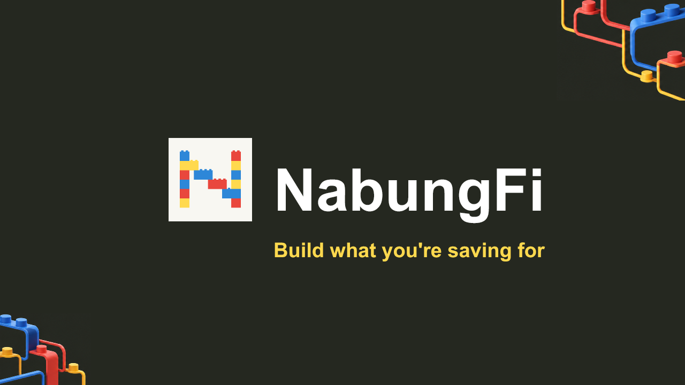

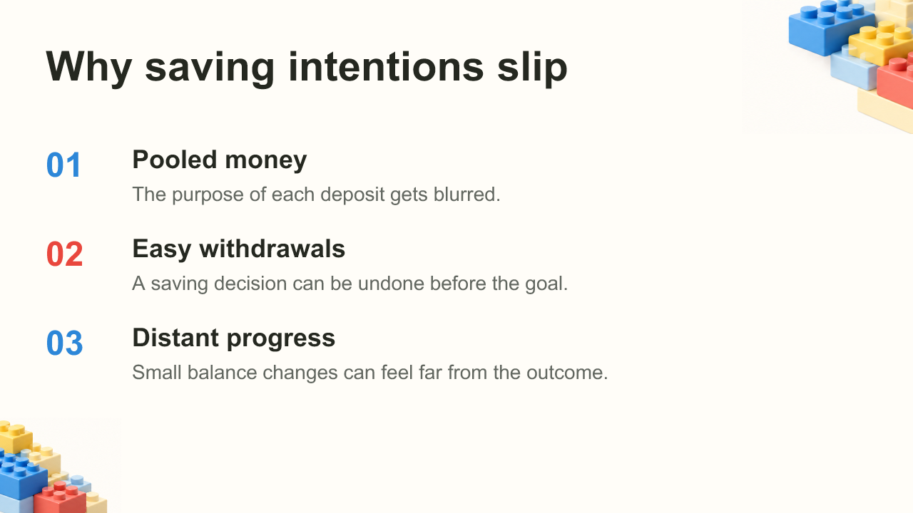

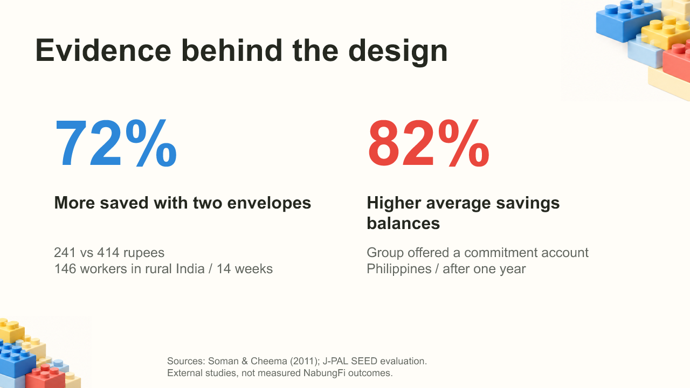

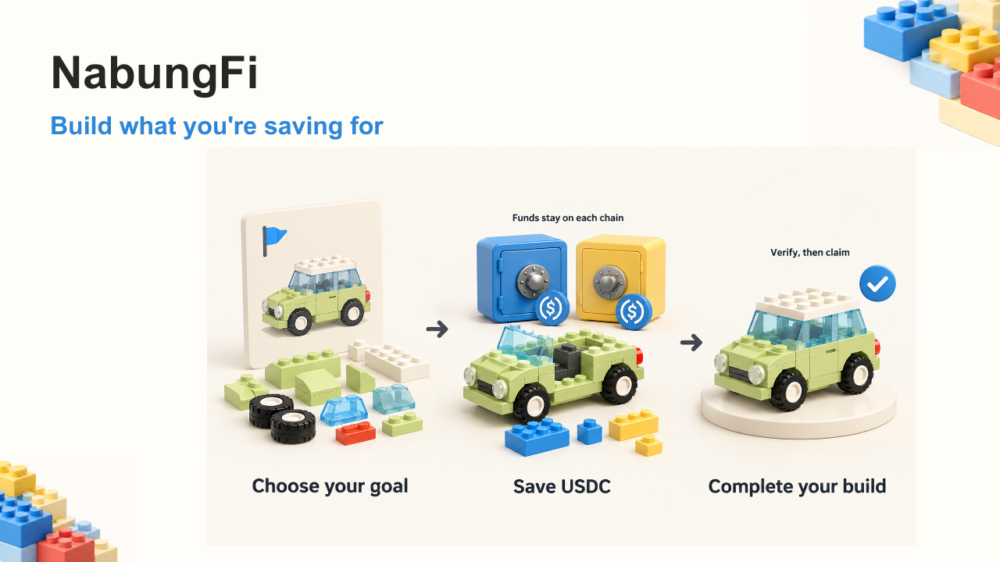

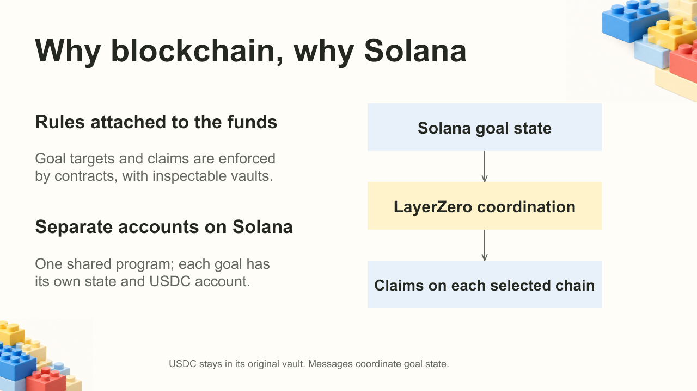

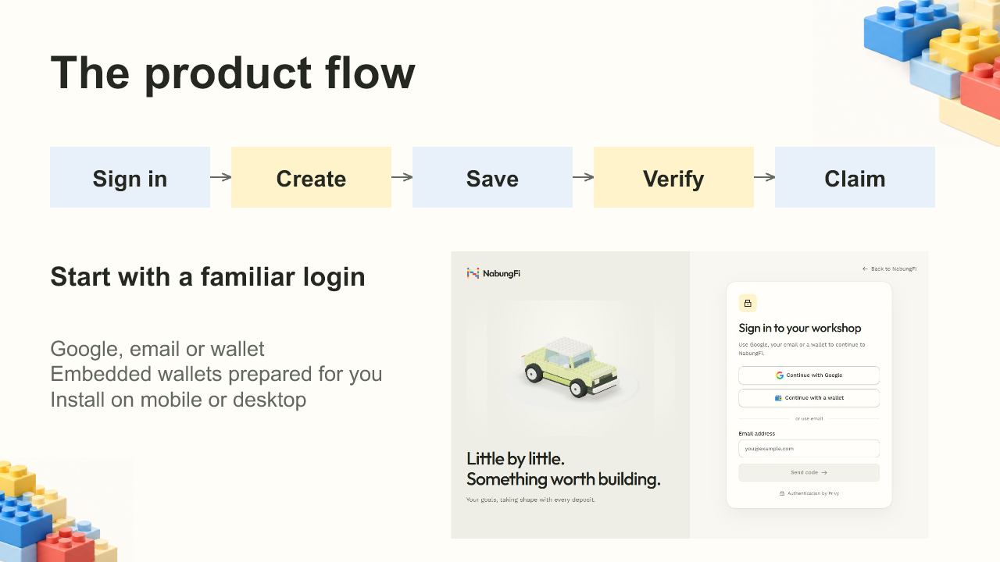

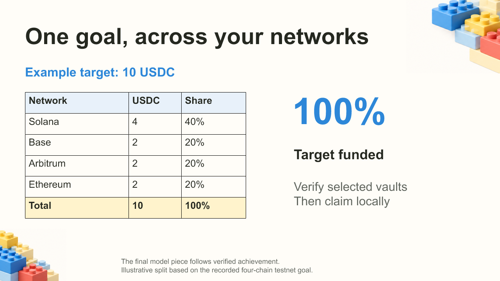

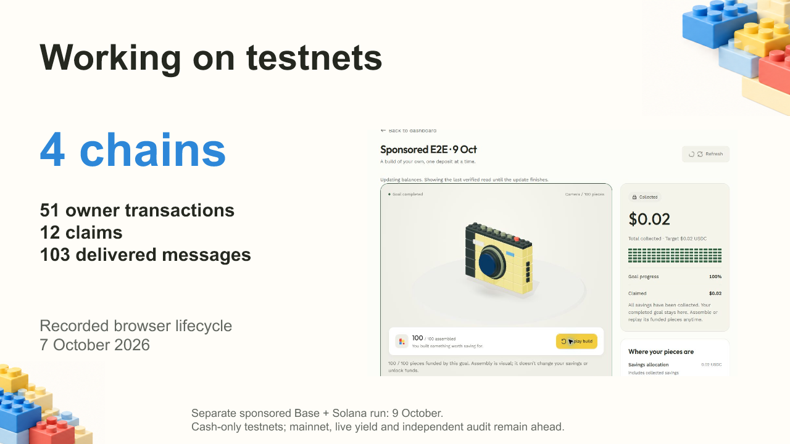

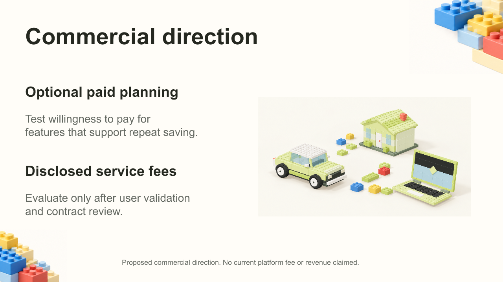

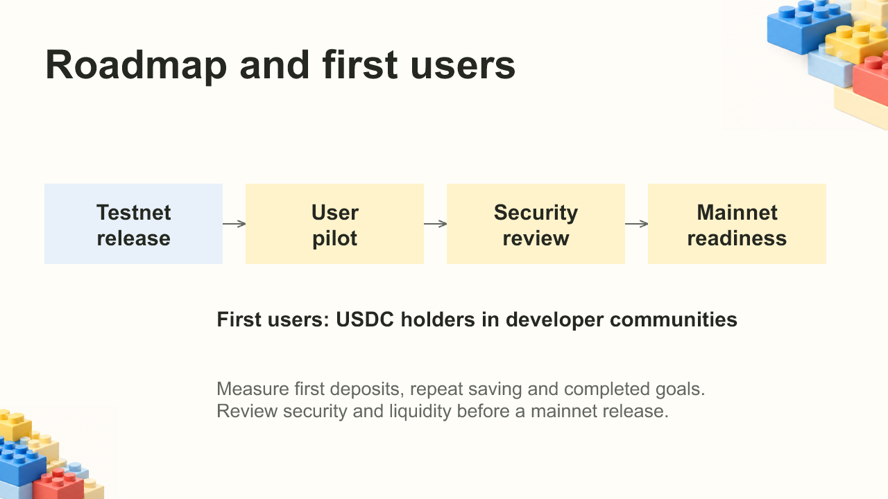

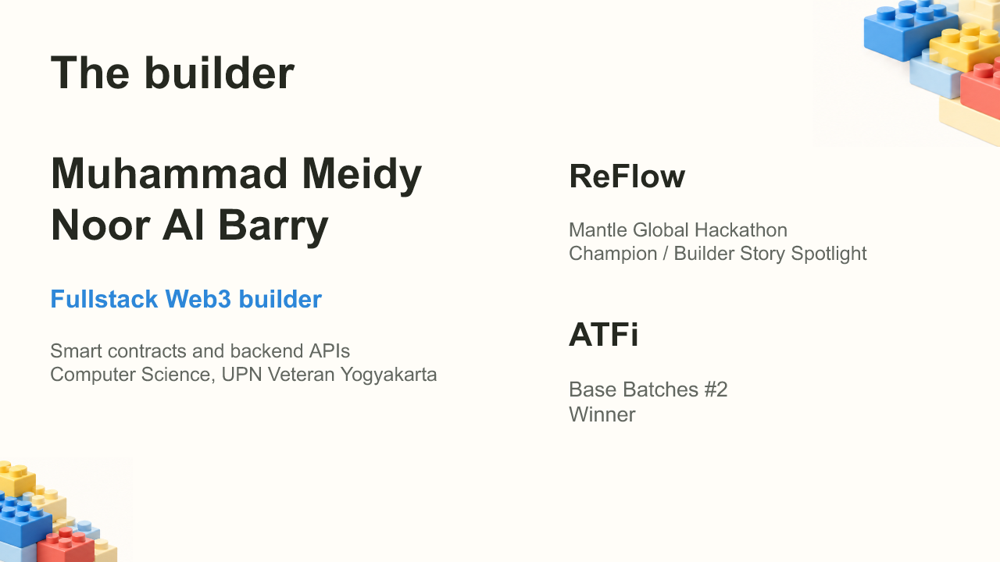

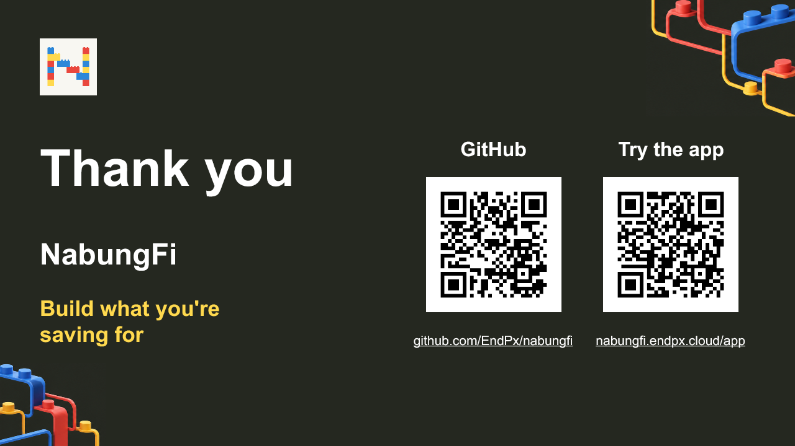
